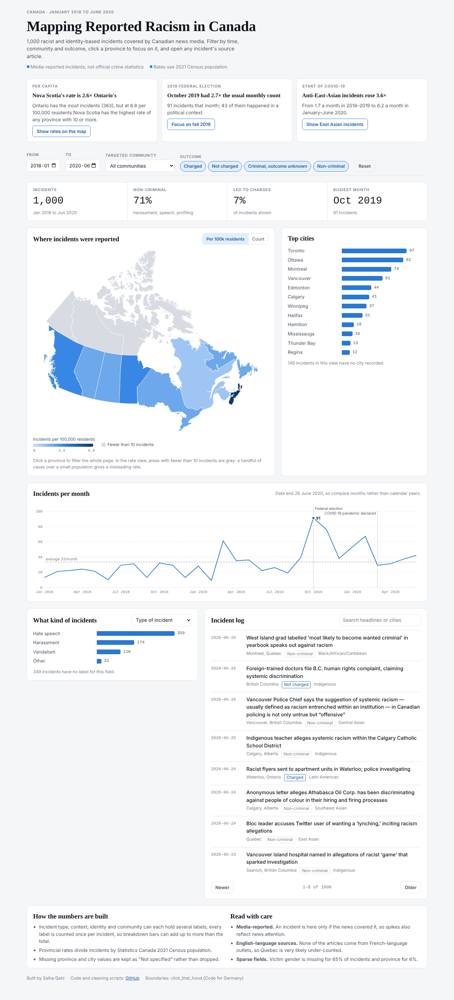
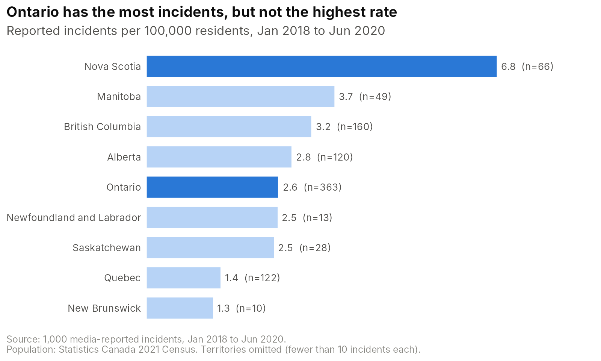
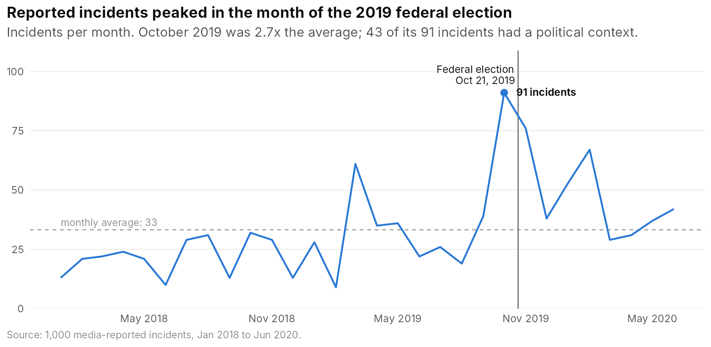
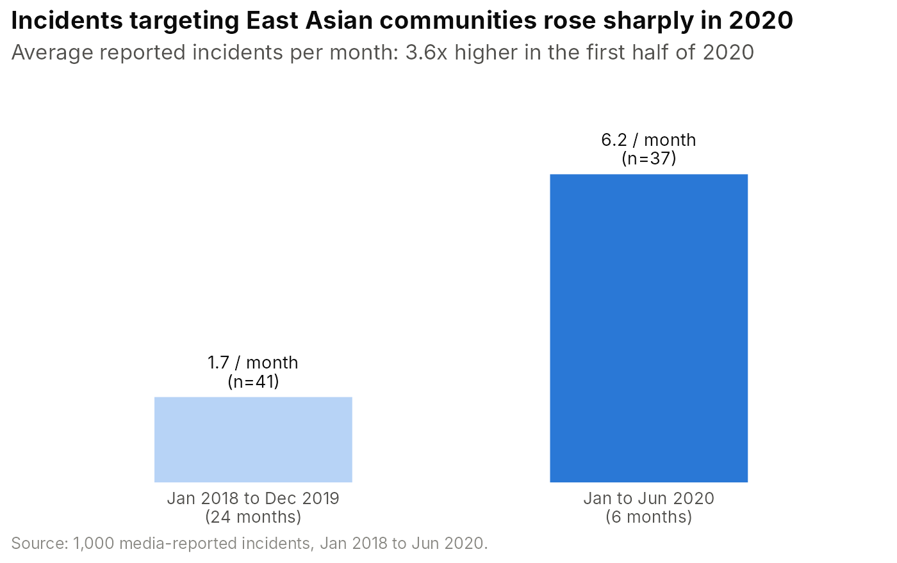
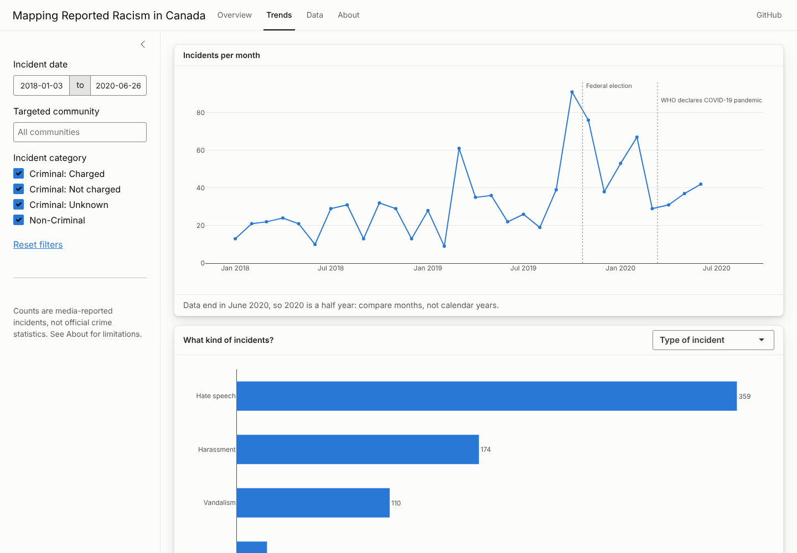

# Mapping Reported Racism in Canada (2018–2020)

An interactive R Shiny dashboard and reproducible analysis of **1,000 racist and identity-based incidents** reported in Canadian news media between January 2018 and June 2020.

**[▶ Interactive dashboard](https://SallyQahl.github.io/canada-racism-incidents/)** · [Shiny app](https://salha-qahl.shinyapps.io/<app-name>/) · [Key findings](#key-findings) · [Methods](#methods) · [Limitations](#limitations)



---

## Key findings

**1. Ontario has the most incidents, but not the highest rate.** Normalizing by population changes the picture: Nova Scotia has the highest rate among provinces with 10+ incidents (6.8 per 100,000 residents), more than twice Ontario's 2.6.



**2. Reported incidents peaked in the month of the 2019 federal election.** October 2019 had 91 incidents, 2.7× the monthly average of 33, and 43 of them had a political context.



**3. Incidents targeting East Asian communities rose sharply at the start of COVID-19.** They went from 1.7 per month in 2018–2019 to 6.2 per month in January–June 2020, a 3.6× increase.



**4. Most reported incidents are not crimes.** 70.5% were non-criminal (harassment, hate speech, profiling), and only 6.9% led to charges. Racism that reaches the news is mostly not something police statistics capture.

All numbers are generated by [`R/02_analysis.R`](R/02_analysis.R) and written to [`outputs/key_findings.md`](outputs/key_findings.md).

---

## The dashboard

There are two versions with the same data:

- **Web dashboard** (`docs/index.html`): a single self-contained page built with D3. It needs no server, so GitHub Pages hosts it for free. Click a province to filter everything, use the story buttons to jump to each finding, and search the incident log.
- **Shiny app** (`app/app.R`): the R version, deployed on shinyapps.io.


| Tab | What it shows |
|---|---|
| **Overview** | Headline metrics, a province map you can switch between *rate per 100k* and *raw count*, and the top 15 cities |
| **Trends** | Monthly incidents with key events marked, plus a breakdown by incident type, context, identity, or targeted community |
| **Data** | Searchable table of every incident, linked to its source article, with CSV download |
| **About** | Methods and limitations |

Filters in the sidebar (date range, targeted community, incident category) apply to every tab.



---

## Methods

**Multi-label fields.** Incident type, context, identity, and community often hold several labels in one cell (e.g. `"Hate speech: Other, Vandalism"`). These are split into a long table so each label is counted once per incident, instead of treating every combination as its own category.

**Per-capita rates.** Provincial counts are divided by Statistics Canada 2021 Census population. Provinces and territories with fewer than 10 incidents are greyed out in the rate view because their rates are unstable (for example, 2 incidents in Nunavut produce a rate close to Nova Scotia's).

**Missing values are explicit.** Missing province, city, and gender values become `"Not specified"` / `"Not reported"` rather than being dropped silently.

**Boundary join is checked.** The cleaning script stops with an error if any province fails to match its polygon or population row, so the map can't silently show a province as "No Data."

---

## Limitations

- **Media-reported, not prevalence.** An incident appears only if a news outlet covered it, so spikes reflect news attention as well as events. These figures should not be read as the true frequency of racism.
- **English-language sources only.** None of the 1,000 source articles come from French-language outlets, so **Quebec is very likely under-counted**. Its low rate (1.4 per 100k) should not be interpreted as less racism.
- **Partial 2020.** Data end on 26 June 2020, so yearly totals are not comparable. The dashboard compares months instead of years.
- **Sparse fields.** Victim gender is missing for 65% of incidents and province for 5.9%.
- **Population year.** Rates use 2021 Census population for a 2018–2020 period, which slightly understates rates in fast-growing provinces.

---

## Repository structure

```
├── R/
│   ├── 01_clean.R           # raw CSV → tidy tables, multi-label split, province join
│   └── 02_analysis.R        # key findings + README figures
├── web/
│   ├── template.html        # web dashboard (D3)
│   └── build.py             # embeds the cleaned data -> docs/index.html
├── app/
│   ├── app.R                # Shiny app (bslib, leaflet, plotly, DT)
│   └── data/                # processed .rds files the app reads
├── data/
│   ├── raw/                 # original incident file
│   ├── reference/           # province boundaries + 2021 Census population
│   └── processed/           # cleaned CSVs for non-R users
├── docs/                    # index.html (GitHub Pages) + README figures and screenshots
├── outputs/key_findings.md
└── install.R
```

## Run it locally

```r
source("install.R")            # install packages (once)
source("R/01_clean.R")         # build app/data/
source("R/02_analysis.R")      # regenerate findings and figures
shiny::runApp("app")
```

Run each script from the repository root.

**Publish the web dashboard:** run `python3 web/build.py`, push, then in GitHub go to *Settings → Pages*, choose *Deploy from a branch*, branch `main`, folder `/docs`. It goes live at `https://SallyQahl.github.io/canada-racism-incidents/`.

**Deploy the Shiny app:** `rsconnect::deployApp("app")`.

## Data sources

- **Incidents:** <!-- TODO: name the dataset/organization the incident file came from, with a link and its license -->
- **Population:** Statistics Canada, 2021 Census of Population.
- **Province boundaries:** [click_that_hood](https://github.com/codeforgermany/click_that_hood) (Code for Germany).

## Author

**Salha Qahl**, PhD (spatial epidemic modelling, University of Calgary) · [LinkedIn](<!-- TODO -->) · [GitHub](https://github.com/SallyQahl)
